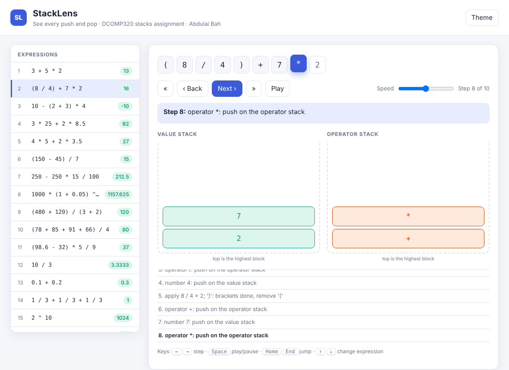

# StackLens: see every push and pop

**Course:** DCOMP320 Data Structures and Algorithms
**Assignment:** Individual Assignment (10%), Stacks Implementation
**Author:** Abdulai Bah, Limkokwing University of Creative Technology, Sierra Leone

StackLens reads maths expressions from `input.txt`, evaluates each one **using stacks**, and writes the answers to `output.txt`, keeping every separator line. It also lets you **watch** the stacks work: it writes `stacklens.html`, a page you open in any web browser to step through every push and pop of every expression.



## What makes it different
| Feature | What it means |
|---|---|
| Exact arithmetic | Numbers are fractions, so `1 / 3 + 1 / 3 + 1 / 3` is exactly `1` and `0.1 + 0.2` is exactly `0.3` |
| Errors with positions | `3 + * 4` gives `unexpected '*' at position 5`; every error says where the problem is |
| Power and signs | `^` (also `**`), right-to-left (`2 ^ 3 ^ 2 = 512`), and `-2 ^ 2 = -4` |
| Visual stack viewer | `stacklens.html`: animated, keyboard friendly, light and dark theme, works on a phone, no internet needed |
| Three stacks in use | Value stack, operator stack, and a bracket-position stack |
| Real-life tests | Test file includes Sierra Leone examples in New Leones (market prices, taxi fares, savings, discounts) |
| 27 automated tests | Including 400 random expressions checked against an independent calculator, and 600 random garbage inputs that must never crash it |

## Files
| File | Purpose |
|---|---|
| `stacklens.py` | The program |
| `input.txt` | Test file: 38 expressions, separated by `-----` |
| `output.txt` | Results generated by the program |
| `test_stacklens.py` | 27 automated tests |
| `trace.txt` | Generated: the working for every expression, as text |
| `stacklens.html` | Generated: the animated visualizer |
| `docs/` | Flowchart, architecture diagram and screenshots (also in the report) |
| `README.md` | This file |

## How to run
Requires Python 3.6 or later. No extra libraries. Works from any folder. On Windows use `py` if `python` is not recognised.

```
python stacklens.py                       # input.txt -> output.txt (+ trace.txt, stacklens.html)
python stacklens.py in.txt out.txt        # use other file names
python stacklens.py --expr "3 + 5 * 2"    # one expression, with its working printed
python stacklens.py --no-visual           # skip trace.txt and stacklens.html
python -m unittest test_stacklens -v      # run the 27 automated tests
```

Then open `stacklens.html` in a browser. Click an expression on the left, then use **Next**, **Back** or **Play**. Keys: Left/Right arrows step, Space plays or pauses, Home/End jump, Up/Down change expression.

## Input and output file formats
**input.txt**: one expression per line. Expressions are separated by a line of dashes (`-----`).
**output.txt**: the same layout. Each expression is replaced by its result and every separator line is copied unchanged.

```
input.txt                  output.txt
3 + 5 * 2                  13
-----                      -----
(8 / 4) + 7 * 2            16
-----                      -----
10 - (2 + 3) * 4           -10
```

## How it works
1. **Bracket check:** a stack of bracket positions finds missing or extra brackets and says exactly where.
2. **Tokenizer:** splits the line into numbers, operators, brackets and negative signs, remembering each position.
3. **Evaluator:** a **value stack** holds numbers; an **operator stack** holds operators waiting for their turn. When an operator arrives, any waiting operator that must go first (higher precedence, or equal precedence and left to right) is calculated, then the new one is pushed. Brackets group work. Power is the exception: it is worked right to left.
4. **Observer:** after every step the evaluator reports both stacks. That is what feeds `trace.txt` and `stacklens.html`.

| Operator | Precedence | Order |
|---|---|---|
| `^` or `**` | 4 (highest) | right to left |
| negative sign `-` | 3 | applied after a power, before `*` and `/` |
| `*` `/` | 2 | left to right |
| `+` `-` | 1 | left to right |

## Assumptions and limitations
- Supported: `+ - * / ^`, brackets, decimals (`2.5`, `.5`), negative numbers (`-5 + 12`, `2 * -3`, `-(2 + 3)`).
- Whole-number results print without a decimal point (`13`). Other results print up to 4 decimal places, rounded (`10 / 3` gives `3.3333`).
- Division is true division: `7 / 2 = 3.5`.
- Powers need a whole-number exponent between -1000 and 1000. Results that would be absurdly large are refused with an error.
- A bad line never stops the program. Its output line shows `Error: ...` with the position, and all other lines are still processed.
- Blank lines are copied as blank lines. A separator is any line of three or more dashes.
- Not supported: variables, functions, implicit multiplication such as `2(3 + 4)`, scientific notation such as `1e3`.

## Note on the handout example
The handout lists the answer to `(8 / 4) + 7 * 2` as 17. The correct answer is 8 / 4 + 7 x 2 = 2 + 14 = **16**, so the program outputs 16. This is deliberate and is explained in the report.

## Putting the project on GitHub
1. Create a new repository on github.com (for example `dcomp320-stacklens`).
2. This folder is already a Git repository with commits. Connect and push:
```
git remote add origin https://github.com/<your-username>/<repo-name>.git
git branch -M main
git push -u origin main
```
3. On GitHub: Settings > Collaborators > Add people, and add your lecturer's GitHub username.
4. Optional, but nice: Settings > Pages > Deploy from branch `main` (root). Your visualizer then has a live web link: `https://<your-username>.github.io/<repo-name>/stacklens.html`.
